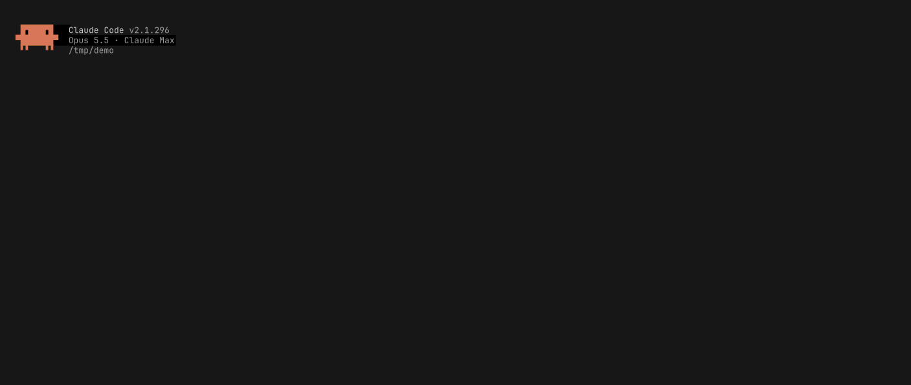

# secrets

Passwords and keys for the commands Claude Code runs, without the agent ever seeing them.

When a command needs a secret (`sudo -A`, ssh, git, or `secrets ask` inside a command), a card appears in the
Claude Code sidebar. You type the value, or pick an entry from your vault, and it goes straight to the program that
asked. The agent sees `[secret]` wherever the value would have shown.

Linux and macOS, provided as is. See [Platforms](#platforms).

## What it does

- **Requests.** `sudo -A`, ssh and git ask through their own helpers (`SUDO_ASKPASS`, `SSH_ASKPASS`,
  `GIT_ASKPASS`); any command can ask with `secrets ask --tag TAG "what it is for"`. Each request is a card in the
  🔐 drawer, or a pop-out while the drawer is closed, naming the command that asked.
- **Vault.** An encrypted file of your passwords, tokens and ssh keys (Argon2id, 64 MiB, t=3; XChaCha20-Poly1305),
  one for every session, unlocked once in the Vault tab. Each session decides per entry: **Ask** (a card each time),
  **Allow** (given with no card), **Deny** (never given); the choice is kept per Claude Code session id, so a
  resumed session keeps it. Subagents and teammates get nothing: their asks and signatures are refused, with no card.
  Entries stay in the order you drag them into (or move with Shift+↑/↓).
- **ssh-agent.** Each session's `SSH_AUTH_SOCK` is a vault agent: it signs with the vault's keys as the session
  allows. With **Forward my SSH agent** ticked for the session, it also offers your own agent's keys and signs with
  them as your agent would, with no card, for anything but a subagent's or a teammate's command.
- **Masking.** Every Bash command runs under `secrets-mask-run` (as `CLAUDE_CODE_SHELL_PREFIX`): what the command
  prints is masked before Claude Code reads it, with the open vault's values and the value the command was handed.
  Other tool results are masked too. A tool call that carries a vault value is stopped before it runs, and a write of
  `[secret]` over a real value is refused.
- **The agent's view.** The tool `mcp__secrets__vault` lists the vault's entries (tag, kind, this session's access,
  name; never a value) and tells the agent how to ask for one.
- **Collisions.** A plugin loaded after this one whose hooks would see secrets in transit (tool calls, HTTP fetches,
  process spawns, environment changes) is shown in the Vault tab; until you allow it, typing and the vault are off.
- **Settings tab.** Unlock at session start, the shortest value masked (default 6 characters), and an
  `autoMode.environment` line for the auto-mode classifier, written to `~/.claude/settings.json` when you click Save.

## What the agent sees

A recorded session with a dummy vault (tags `db`, `deploy`, `github`) and a local stand-in API that echoes the
bearer token back. The prompt: *Check that the staging API accepts our deploy token: GET
http://localhost:8080/v1/whoami with it as a Bearer token.*



The agent looks the vault up:

```
mcp__secrets__vault {}
```
```
tag     kind      access  name
db      password  ask     Prod DB
deploy  token     ask     Deploy token
github  ssh-key   ask     GitHub
```

It puts the ask inside the command that needs the value:

```sh
curl -sS -w '\nHTTP %{http_code}\n' \
  -H "Authorization: Bearer $(secrets ask --tag deploy 'Deploy token for staging API whoami check')" \
  http://localhost:8080/v1/whoami
```

A card for the `deploy` entry pops out in the sidebar. **Allow once** hands the token to this call; **Allow for
session** also allows the entry for the rest of the session, so its next asks get it with no card. The API sends the token back in its
reply; what reaches the agent is:

```
{"user":"deploy-bot","scopes":["deploy:staging"],"token":"[secret]"}
HTTP 200
```

and it answers from what it could see: *The staging API accepts the deploy token. GET /v1/whoami returned HTTP 200:
User: deploy-bot, Scopes: deploy:staging. The response also sent the token back in a token field. It was redacted in
the output, so I never saw the token itself.*

## Threat model

It guards against **accidents**: an agent printing a secret, writing it into a file, a log or a note, pasting it into
another command, or sending it somewhere it doesn't belong. It does **not** defend against a malicious agent, a
malicious plugin, or another process running as you:

- A process running as your user can talk to your ssh-agent socket and ask the daemon for things the same way a
  command can; the daemon checks who asks by the peer's process (see [Platforms](#platforms)), which holds against a
  mistaken command, not against code built to imitate one.
- Plugins loaded before this one are not checked; Claude Code runs them first.
- Your own settings hooks (`PostToolUse` and the like) receive tool results before they are masked.
- A value a command has been handed is in that command's memory and environment; what the command does with it is
  up to the command.

## Known limits

- Masking is by value: a value shorter than the minimum (default 6) is masked only in the call that asked for it,
  and a value transformed beyond its common encodings (base64, URL, hex, JSON escapes) isn't recognised.
- A closed vault masks nothing but the value a running call was just handed.
- A paste of 3 or more lines, or 800 or more characters, folds into the prompt and can't be routed to a card; you get
  an error and the prompt is held back once.
- A paste right after Escape still goes to the selected card (Claude Code doesn't tell a plugin about Escape).
- ssh keys must be unencrypted OpenSSH keys; passphrase-protected keys aren't supported.
- A restart of the daemon (an update, a crash) locks the vault, and requests waiting at that moment fail.
- Your own prompt text is never masked.

## Platforms

The security rests on the kernel and the service manager, so each platform has its own way to the same guarantees;
other systems aren't supported.

- **Linux.** The daemon identifies callers with `SO_PEERCRED` and `/proc/<pid>/{exe,stat,cmdline}`, marks itself
  non-dumpable, relies on Yama `ptrace_scope` 1 or higher so one command can't read another's memory, and runs as a
  systemd user service with socket activation.
- **macOS.** Callers are identified with `LOCAL_PEEREPID`, `proc_pidinfo`, `proc_pidpath` and `kern.procargs2`. The
  peer pid macOS reports is the last process that used the peer's socket, where Linux reports the one that
  connected; a socket passed to or shared with another process counts as that process's. The daemon is signed with
  the hardened runtime and without `get-task-allow`, which keeps every debugger out, root's included, and refuses to
  start when it isn't; core dumps are off. It runs as a launchd agent that holds its socket, `$TMPDIR/secrets.sock`,
  and starts it on the first connection.

## Requirements

- Linux with systemd (user services) and Yama `ptrace_scope` ≥ 1, or macOS with Xcode's command line tools
  (`codesign`).
- Claude Code 2.1.293 or later, in fullscreen rendering.
- The [sidebar](https://github.com/wfthkttn/sidebar) plugin, which draws the 🔐 drawer.

## Install

secrets is two parts that must come from the same build: the daemon, a systemd user service, and the plugin, whose
`bin/` holds the helpers the daemon accepts calls from. Claude Code loads the plugin from a directory listed in
`CLAUDE_CODE_PLUGIN_DIRS`, with secrets first: it checks only the plugins loaded after it.

### NixOS

```nix
# flake.nix
inputs.claude-secrets.url = "github:wfthkttn/claude-secrets";
inputs.sidebar.url = "github:wfthkttn/sidebar";

# configuration
imports = [ inputs.claude-secrets.nixosModules.default ];
services.claude-secrets.enable = true;
environment.systemPackages = [ inputs.sidebar.packages.x86_64-linux.default ];
environment.pathsToLink = [ "/share/sidebar" ];
```

Then in `~/.claude/settings.json`:

```json
"env": {
  "CLAUDE_CODE_PLUGIN_DIRS": "/run/current-system/sw/share/secrets/claude-code:/run/current-system/sw/share/sidebar/claude-code"
}
```

### Without Nix

Needs Rust 1.95 or later.

```sh
git clone https://github.com/wfthkttn/sidebar
git clone https://github.com/wfthkttn/claude-secrets
cd claude-secrets
cargo build --release
mkdir -p ~/.config/systemd/user
cat > ~/.config/systemd/user/secrets.socket <<EOF
[Unit]
Description=secrets vault daemon socket

[Socket]
ListenStream=%t/secrets.sock
SocketMode=0600

[Install]
WantedBy=sockets.target
EOF
cat > ~/.config/systemd/user/secrets.service <<EOF
[Unit]
Description=secrets vault daemon

[Service]
ExecStart=$PWD/target/release/secrets-relay daemon
Restart=on-failure
RestartSec=5
EOF
systemctl --user daemon-reload
systemctl --user enable --now secrets.socket
```

Then in `~/.claude/settings.json`, with the two clones' paths:

```json
"env": {
  "CLAUDE_CODE_PLUGIN_DIRS": "/path/to/claude-secrets/claude-code:/path/to/sidebar"
}
```

After a rebuild, `systemctl --user restart secrets.service`, so the daemon runs the build the plugin calls; the
restart locks the vault.

### macOS

Needs Rust 1.95 or later.

```sh
git clone https://github.com/wfthkttn/sidebar
git clone https://github.com/wfthkttn/claude-secrets
claude-secrets/macos/install.sh
```

It builds, installs the binaries and the plugin under `~/.local/lib/secrets`, signs the daemon, and loads the launchd
agent `local.claude-secrets`; its log is `~/Library/Logs/claude-secrets.log`. Run it again after an update; it
stops the running daemon, which locks the vault. Then in `~/.claude/settings.json`, with your home and the sidebar
clone's path:

```json
"env": {
  "CLAUDE_CODE_PLUGIN_DIRS": "/Users/you/.local/lib/secrets/claude-code:/path/to/sidebar"
}
```

## How it works

- `secrets-relay daemon`: one per user, started by its socket (systemd's `secrets.socket`, launchd's
  `local.claude-secrets`). It owns the vault file
  (`$XDG_DATA_HOME/secrets/vault`, else `~/.local/share/secrets/vault`) and each session's access file
  (`sessions/<session-id>.json` beside it).
- `secrets-relay attach`: started by the plugin's hooks in each session; the session's Claude Code process is its
  parent, which is how the daemon knows the session. It prints the session's events (asks, signatures, vault
  changes) for the hooks, and gets the session its own sockets (requests, ssh-agent).
- `secrets-mask-run`: the shell prefix; streams each command's output through the daemon.
- `secrets`, `secrets-askpass-{sudo,ssh,git}`: what commands call to ask.
- `claude-code/`: the plugin (TypeScript hooks and the views drawn in the sidebar).

## Build and test

```sh
cargo build --release      # claude-code/bin points at target/release
cargo test                 # run outside a session that has this plugin loaded
cd claude-code && claude plugin test && claude plugin validate .
```

On macOS, `cargo test -- --test-threads=4`: each test's daemon copies its helpers, macOS checks a new executable at
its first run (about 0.3 s), and with a test on every core the timing tests run out of time.

## Licence

MIT, see [LICENSE](LICENSE).
